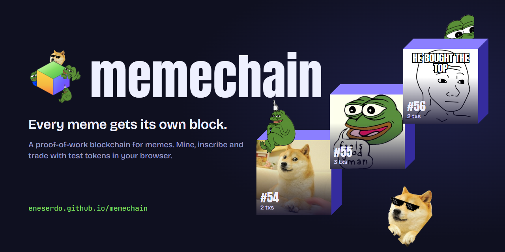
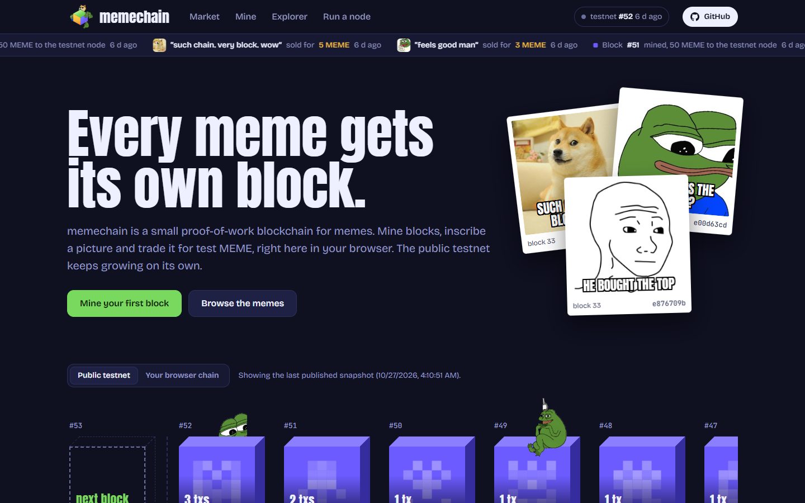
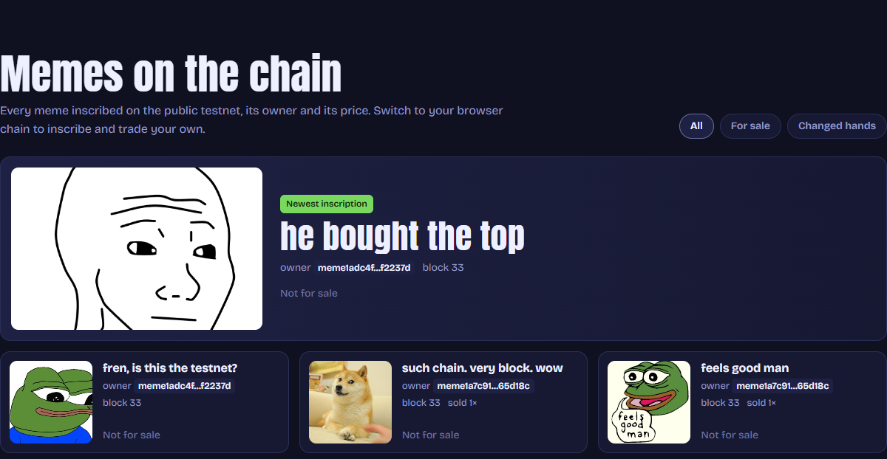
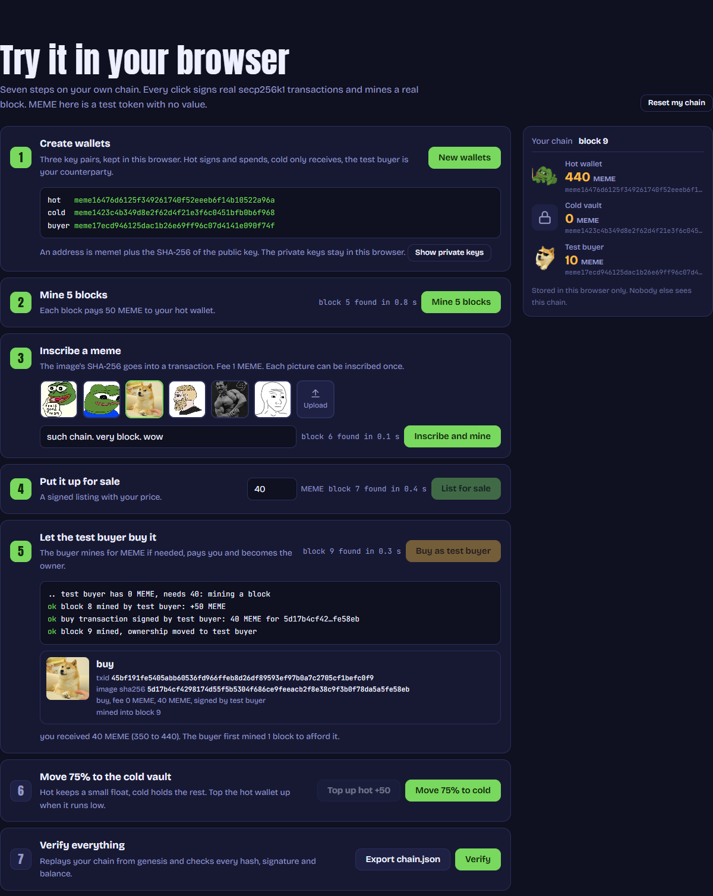
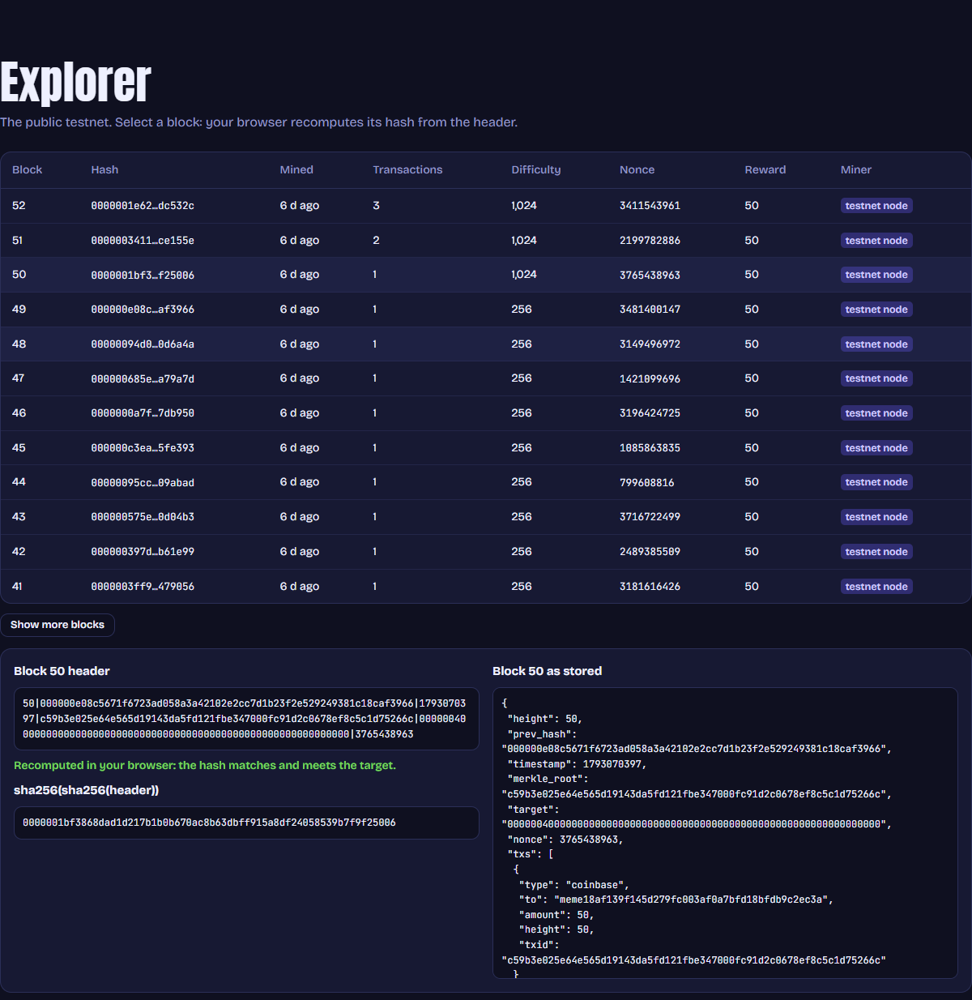
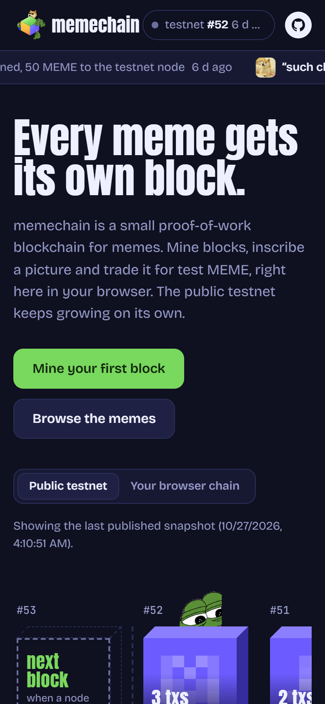

<p align="center">
  
</p>

<h3 align="center">A proof-of-work blockchain for memes. Mine, inscribe and trade them in your browser.</h3>

<p align="center">
  <a href="https://larajeftic.github.io/memechain/"></a>
  <a href="https://github.com/larajeftic/memechain/actions/workflows/testnet.yml"></a>
  
  <a href="LICENSE"></a>
</p>

<p align="center">
  <a href="https://larajeftic.github.io/memechain/"><b>Open memechain</b></a> ·
  <a href="https://larajeftic.github.io/memechain/#mine">mine your first block</a> ·
  <a href="https://larajeftic.github.io/memechain/#explorer">explore the testnet</a>
</p>

---

memechain is a small blockchain where every meme is an inscription: the picture's SHA-256 goes into a signed
transaction, a miner puts it into a block, and from then on the meme has one owner who can list it and sell it.
The same consensus rules run twice: in `node.py` for the public testnet, and in `docs/chain.js` inside your browser,
where you can mine, inscribe and trade on a chain of your own without installing anything.

## Preview

<table>
  <tr>
    <td width="50%"><br><sub><b>Live chain.</b> The newest testnet blocks as a strip, the next block on the left, the newest memes on the right.</sub></td>
    <td width="50%"><br><sub><b>Memes on the chain.</b> Every inscription with owner, block and price. Filter by for sale or sold.</sub></td>
  </tr>
  <tr>
    <td><br><sub><b>Try it in your browser.</b> Seven steps: wallets, mining, inscribing, listing, a sale to a test buyer, a cold vault, a full re-verification.</sub></td>
    <td><br><sub><b>Explorer.</b> Pick a block and your browser recomputes its double SHA-256 from the header.</sub></td>
  </tr>
</table>

<p align="center"></p>

## What you can do

- **Watch the public testnet.** A [GitHub Actions job](.github/workflows/testnet.yml) mines a few blocks every
  20 minutes with `node.py`'s own code, inscribes memes from [`testnet/pool/`](testnet/pool) and stamps every 10th
  block into Bitcoin with OpenTimestamps. The site reads the export from the
  [`testnet` branch](https://github.com/larajeftic/memechain/tree/testnet), so it shows new blocks without anyone
  running a server.
- **Mine your own chain in the browser.** One click per step. Every click signs real secp256k1 transactions
  ([noble-secp256k1](https://github.com/paulmillr/noble-secp256k1)) and mines a real block. Your chain stays in
  `localStorage`; nobody else sees it.
- **Inscribe any picture.** Pepe, Apu, Doge, Chad, GigaChad, Wojak or your own jpg, png, gif or webp up to 250 KB.
  Each picture can be inscribed once per chain.
- **Trade it.** List a meme, let the test buyer mine for MEME and buy it, sell it back. Move 75 % of your MEME to a
  cold vault that only receives: the hot/cold treasury pattern, rehearsed with test tokens.
- **Check everything.** *Verify* replays your chain from genesis. *Export* gives you a `chain.json` that the Python
  node confirms: `python tools/validate_export.py memechain-browser-chain.json`.
- **Get your meme on the testnet.** Open a pull request that adds an image to `testnet/pool/` and a caption to
  `testnet/pool/captions.json`. The bot inscribes the pool one meme at a time.

## How the chain works

| | |
|---|---|
| Proof of work | double SHA-256 over `height\|prev\|time\|merkle\|target\|nonce`, Bitcoin-style |
| Block time | 60 s target, retarget every 10 blocks, clamped to 0.25x to 4x |
| Reward | 50 MEME per block plus fees, halving every 100,000 blocks |
| Wallets | secp256k1, RFC 6979 signatures over canonical JSON, address = `meme1` + SHA-256 of the public key |
| Memes | the chain stores the image hash, size and caption; nodes and the explorer keep the bytes |
| Fork choice | longest valid chain; every 10th block hash anchored in Bitcoin via OpenTimestamps |
| Browser chain | identical rules, only `MC_INITIAL_BITS=16` and `MC_BLOCK_TIME=1` so blocks take about a second on a phone |

| Transaction | Fields | Rule |
|---|---|---|
| `coinbase` | `to`, `amount`, `height` | first tx of a block; amount = reward + fees |
| `transfer` | `to`, `amount`, `fee` | sender balance ≥ amount + fee |
| `meme` | `img_sha256`, `img_ext`, `img_size`, `caption`, `fee` ≥ 1 | image hash not inscribed yet; sender becomes owner |
| `sell` | `img_sha256`, `price` (0 = delist) | sender owns the meme |
| `buy` | `img_sha256`, `amount` = listed price, `fee` | meme is listed; price goes to the owner, ownership to the buyer |

Every non-coinbase transaction carries `from`, `pubkey`, `nonce`, `sig` and `txid`. State is balances, seen nonces,
owners (`img_sha256 → address`) and listings (`img_sha256 → price`).

## Run a node

```sh
git clone https://github.com/larajeftic/memechain
cd memechain
pip install flask requests ecdsa pillow opentimestamps-client
python node.py            # explorer and API on http://localhost:5050
```

The node mines to its own wallet in `data/wallet.json` (git-ignored, keep it private). With `MC_PUBLISH=1` it commits
the explorer export to `docs/` after each block; with a `GITHUB_TOKEN` in `.env` it inscribes images posted as issues.

Environment: `MC_PORT`, `MC_PEERS`, `MC_MINE`, `MC_PUBLISH`, `MC_INITIAL_BITS`, `MC_BLOCK_TIME`, `MC_DATA`, `MC_DOCS`,
`MC_ANCHOR_EVERY`, `MC_GH_REPO`.

API: `GET /api/status`, `/api/chain`, `/api/block/<height|hash>`, `/api/mempool`, `/api/balance/<addr>`, `/api/market`,
`/api/wallet/new`; `POST /api/faucet {"address"}`, `/api/meme` (multipart `image`, `caption`, `private_key`),
`/api/tx`, `/api/block`, `/api/peers`; `GET /meme/<sha256>`.

## Project layout

```
node.py                      testnet node: consensus, miner, P2P, export, OpenTimestamps, issue intake
docs/                        the website (GitHub Pages, branch main, folder /docs)
  index.html, style.css      page and theme
  app.js                     testnet view, browser miner, market, explorer
  chain.js                   consensus rules ported from node.py (noble-secp256k1 + noble-hashes in vendor/)
  img/                       bundled memes and the Pepe/Doge characters, see img/ATTRIBUTION.md
  logo.html, logo.png        the mark: the block with the characters, rendered to logo.png, icons and favicons
  readme/                    banner source and the screenshots in this README
testnet/pool/                images the testnet bot inscribes, with captions.json
tools/testnet_bot.py         one bot run: load + re-validate, mine, inscribe, anchor, export
tools/logo_assets.py         renders docs/logo.html into logo.png, icon-512/192, apple-touch icon and favicons
tools/readme_assets.py       renders banner, social preview and screenshots (runs logo_assets.py first)
tools/validate_export.py     validates any exported chain with node.py's code
tests/                       JS-to-Python cross validation, unit tests, Playwright walkthrough
```

## Development

```sh
python tools/serve.py 8080         # serve docs/ with correct MIME types
npm test                           # JS chain export -> Python validator -> unit tests
python tests/e2e_browser.py        # Playwright walkthrough in the installed Chrome
python tools/readme_assets.py      # regenerate the README images
python tools/check_public.py       # no credentials in docs/ or the git index
```

No build step: GitHub Pages serves `docs/` as it is.

## Honest notes

- MEME is a test token. It has no value, is not sold and cannot be bought with money. There is no payment code here.
- The browser chain is a demonstration, not a network: every visitor builds their own, and the buyer is a second key
  in the same browser.
- The testnet is a small CPU-mined chain that grows only while the bot or a node runs it. A small proof-of-work chain
  is cheap to rewrite; the Bitcoin anchors make a rewrite detectable, not impossible.
- The site shows what the code computed. There are no user counts, volumes, partners or endorsements.

## Ideas for later

Deliberately outside this demo, never a token sale and never a promise of returns: real-money sales of memes with a
hot/cold treasury (the on-chain `sell`/`buy` flow exists, settlement would go through a payment provider), pinning and
hosting of meme images for node operators, a clearly labelled sponsored slot in the explorer, prints with block hash and
timestamp, and private chains with these rules for teams.

## Credits and license

MIT, see [`LICENSE`](LICENSE). Chain pattern after [Learn Blockchains by Building One](https://github.com/dvf/blockchain)
(MIT) and Bitcoin's header and retarget rules. Cryptography by noble-secp256k1 and noble-hashes (MIT). Meme images and
the Pepe/Doge characters are small non-commercial demo copies, credited in
[`docs/img/ATTRIBUTION.md`](docs/img/ATTRIBUTION.md) and removed on request.
